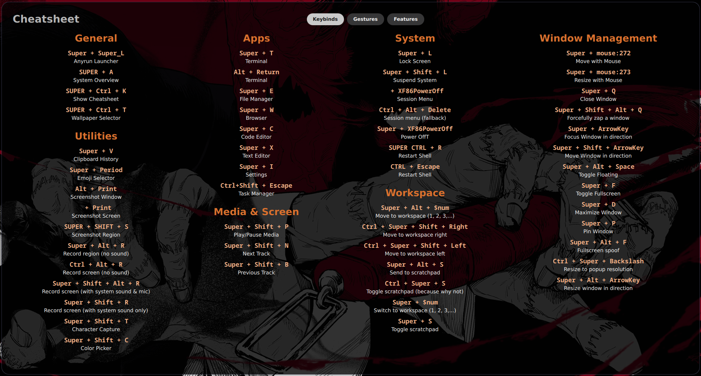
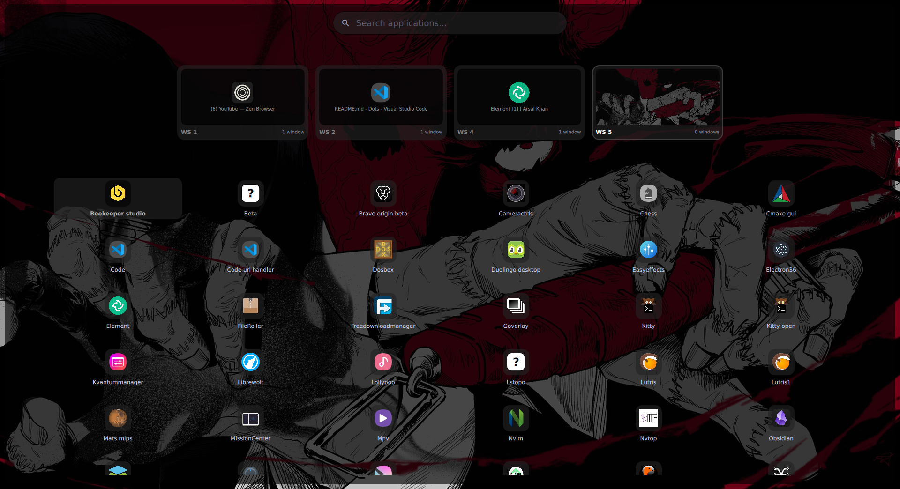

# 🌌 Zenith: The Universal Desktop Experience (NixOS & Arch Linux)

[](LICENSE)
[](https://hyprland.org)
[](https://nixos.org)
[](https://archlinux.org)
[](https://github.com/outfoxxed/quickshell)

Welcome to **Zenith**, a fluid, high-performance Linux desktop environment powered by **Hyprland** and **Quickshell**.

Zenith is organized into three modular repositories:

| Repository | Role | Purpose |
| :--- | :--- | :--- |
| **[zenith](https://github.com/zaeemali272/zenith)** *(this repo)* | **System & Dotfiles** | Unified user dotfiles (`dots/`), declarative NixOS Flakes & modules, and Arch Linux installer. |
| **[zenith-shell](https://github.com/zaeemali272/zenith-shell)** | **Desktop Shell UI** | Complete Qt6/QML desktop interface: Dynamic Island, top bar, sidebar, dashboard, and lockscreen. |
| **[zenith-cli](https://github.com/zaeemali272/zenith-cli)** | **Desktop & System CLI** | Unified command line interface for shell switching, special workspaces, media, and system maintenance. |

---

## 🎥 Video Showcase

[](https://www.youtube.com/watch?v=09G4APMCORQ)

<details>
<summary>📸 Click to view screenshot gallery</summary>

<p align="center">
  <br>
  <br>
  <br>
  <br>
  <br>
  
</p>

</details>

---

## 🚀 Installation & Setup

Zenith provides first-class support for both **NixOS** and **Arch Linux**. Choose your distribution below:

### ❄️ Option 1: NixOS (Declarative Flake)

Zenith on NixOS is fully reproducible and configured through modern Nix Flakes.

#### 1. Clone the repository
```bash
git clone https://github.com/zaeemali272/zenith.git ~/zenith/zenith
cd ~/zenith/zenith
```

#### 2. Configure for your machine
Each machine has its own hardware configuration in `hosts/<hostname>/`:
```bash
# Set your target machine name (default: your current hostname)
HOST="$(hostname)"
mkdir -p "hosts/$HOST"

# Generate hardware configuration for your disks and controllers
sudo nixos-generate-config --show-hardware-config > "hosts/$HOST/hardware-configuration.nix"

# Create host default.nix
cat <<EOF > "hosts/$HOST/default.nix"
{ config, pkgs, vars, ... }:
{
  imports = [
    ./hardware-configuration.nix
    ../../modules/core
  ];
  networking.hostName = "$HOST";
}
EOF
```

#### 3. Update `vars.nix`
Edit [`vars.nix`](vars.nix) to match your username:
```nix
{
  user = "your-username";
  terminal = "kitty";
  browser = "zen";
}
```

#### 4. Build and activate the system
```bash
# Test and switch to the new system generation
sudo nixos-rebuild switch --flake .#$HOST

# Or using nh (Nix Helper, if installed)
nh os switch .#$HOST
```

#### 5. Verify system health
```bash
zenith doctor
```

---

### 🏹 Option 2: Arch Linux (Automated Installer)

Zenith transforms a minimal Arch Linux installation into a fully tuned workstation in one command.

#### 1. Prerequisites
Ensure `git` and `base-devel` are installed:
```bash
sudo pacman -S --needed --noconfirm git base-devel
```

#### 2. Clone and run the installer
```bash
git clone https://github.com/zaeemali272/zenith.git ~/zenith/zenith
cd ~/zenith/zenith
./install.sh
```

#### 3. Installation flags
You can customize the installer by passing flags:
```bash
./install.sh --auto           # Unattended mode with sensible defaults
./install.sh --configs        # Only link dotfiles without modifying system packages
./install.sh --gaming         # Include optional gaming packages (wine, winetricks)
./install.sh --no-themes      # Skip optional external themes
./install.sh --status         # Check installer completion status
./install.sh --force          # Re-run all steps from scratch
```

#### 4. Automated system tuning performed on Arch
- **Mirror Optimization**: Uses `reflector` to select the lowest-latency regional mirrors.
- **Pacman Acceleration**: Enables parallel downloads (`ParallelDownloads = 10`) and colorful terminal progress.
- **Makepkg Multi-threading**: Automatically allocates all CPU cores for fast AUR package builds.
- **Dynamic ZRAM**: Sets up high-speed RAM swap with zstd compression.
- **Hardware Autodetection**: Detects GPU (NVIDIA, AMD, Intel) and laptop power controls (`brightnessctl`, `tlp`).

---

## ⚡ Unified Dotfiles (`dots/`)

Zenith stores all configurations together in [`dots/`](dots/):

- **`dots/hypr/`**: Hyprland configuration with modular Lua architecture (`hyprland.lua`, `keybinds.lua`, `animations.lua`, `rules.lua`, `execs.lua`).
- **`dots/kitty/`**: Kitty GPU terminal configuration with dynamic theme integration.
- **`dots/fish/`**: Fish shell configuration with custom functions, completions, and aliases.
- **`dots/btop/`**: System monitor with customized Zenith color scheme.
- **`dots/yazi/`**: Terminal file manager configuration and theme.
- **`dots/starship.toml`**: Minimalist prompt configuration.

---

## 🛠️ Zenith CLI Reference (`zenith`)

The `zenith` CLI tool manages your desktop environment and operating system:

```bash
# System Operations (Dual-Distro)
zenith doctor                       # 10-point system health & diagnostic check
zenith rebuild [switch|boot|test]   # Rebuild system configuration (NixOS: nh/nixos-rebuild; Arch: yay/pacman)
zenith update                       # Pull repository updates and rebuild
zenith rollback                     # Boot previous NixOS generation
zenith gc [days]                    # Garbage collect old generations / package cache
zenith clean [days]                 # Deep disk cleanup (temp files, cache, journalctl, store)
zenith where                        # Print active configuration directory

# Desktop Shell Management
zenith shell switch <name>          # Switch desktop shell (zenith, caelestia, end-4)
zenith shell restart                # Restart the active desktop shell
zenith shell list                   # Show available desktop shells
zenith shell kill                   # Stop all running desktop shell instances

# Workspaces & Media
zenith toggle <workspace>           # Toggle special workspace (sysmon, communication, music, todo)
zenith screenshot [-r|-f]           # Take fullscreen or region screenshot with swappy editor
zenith record [-r|-s|-p]            # Toggle screen recording (with sound, region, or pause)
zenith wallpaper -f <path>          # Set wallpaper via awww and regenerate color palette
zenith clipboard [-d]               # Clipboard history picker via Fuzzel
zenith emoji                        # Emoji and glyph picker
```

---

## ⌨️ Essential Keybindings & Gestures

| Keybinding | Action |
| :--- | :--- |
| <kbd>Super</kbd> | Open application launcher (active shell) |
| <kbd>Super</kbd> + <kbd>Return</kbd> | Open Kitty terminal |
| <kbd>Super</kbd> + <kbd>E</kbd> | Open Thunar file manager |
| <kbd>Super</kbd> + <kbd>Q</kbd> | Close active window |
| <kbd>Super</kbd> + <kbd>V</kbd> | Open clipboard history |
| <kbd>Super</kbd> + <kbd>M</kbd> | Toggle Spotify / Music scratchpad |
| <kbd>Super</kbd> + <kbd>D</kbd> | Toggle Discord / Chat scratchpad |
| <kbd>Super</kbd> + <kbd>Tab</kbd> | Toggle Btop system monitor scratchpad |
| <kbd>PrintScreen</kbd> | Interactive region screenshot |
| <kbd>Super</kbd> + <kbd>PrintScreen</kbd> | Fullscreen screenshot |
| <kbd>Super</kbd> + <kbd>Shift</kbd> + <kbd>R</kbd> | Toggle screen recording |

### Touchpad Gestures
- **Swipe 4 fingers left/right**: Switch workspaces.
- **Swipe 3 fingers up/down**: Adjust audio volume smoothly with OSD.
- **Hold <kbd>Super</kbd> + swipe 3 fingers up/down**: Adjust screen brightness.
- **Pinch 3 fingers**: Play/pause current media track.

---

## ❓ Frequently Asked Questions

<details>
<summary><b>How do I change monitor resolution or refresh rate?</b></summary>
Edit <code>dots/hypr/monitors.lua</code> (or <code>monitors.conf</code>) and set your output name, resolution, and refresh rate. Run <code>hyprctl reload</code> to apply.
</details>

<details>
<summary><b>How do I switch wallpapers?</b></summary>
Run <code>zenith wallpaper -f /path/to/image.png</code> or use the wallpaper picker in Zenith Shell. It will automatically re-extract Material You color palettes for the shell, terminal, and widgets.
</details>

<details>
<summary><b>Where are shell logs stored?</b></summary>
Quickshell logs are output to <code>/tmp/quickshell.log</code> and can be viewed with <code>zenith shell log</code>.
</details>

---

## 📜 License

Licensed under the [MIT License](LICENSE).
