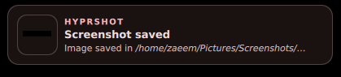
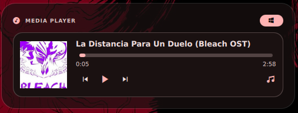
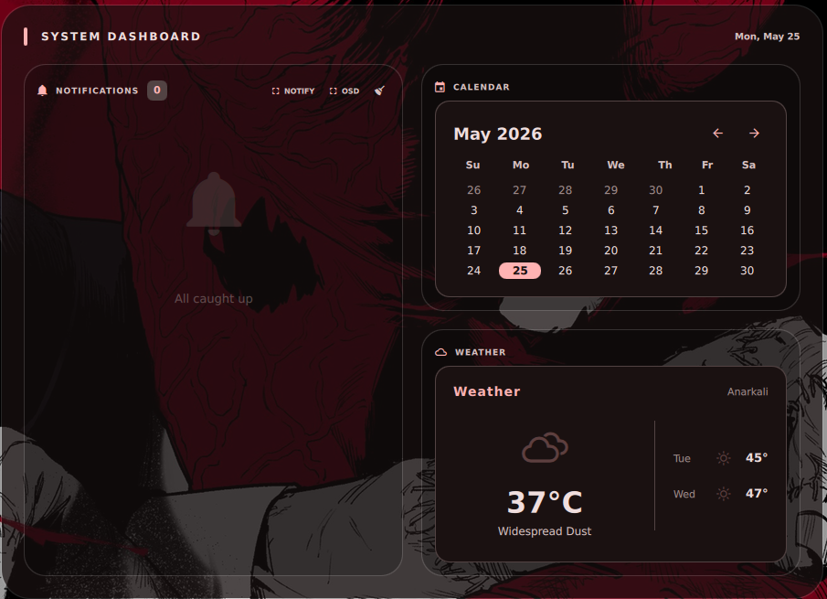

# 🌌 Zenith: The Ultimate Linux Experience (Arch Linux & NixOS)

Welcome to **Zenith**, a meticulously crafted, performance-oriented, and aesthetically stunning modern desktop environment powered by **Hyprland** and **Zenith Shell**. Zenith provides an all-in-one ecosystem with automated installation and reproducible flake configurations for both **Arch Linux** and **NixOS**.

---

## 🚀 The Zenith Philosophy
Zenith is built on three pillars:
1.  **Automation & Reproducibility**: From mirrors and hardware drivers to declarative flakes, everything is handled with zero friction.
2.  **Performance**: System-level optimizations (ZRAM, Pacman tuning, Makepkg, kernel tuning) ensure your hardware runs at peak responsiveness.
3.  **Aesthetics**: A cohesive, modern look using dynamic Material Design schemes, unified multi-shell shortcuts, and intuitive UX.

---

## 🎥 Quick Overview
  <[](https://www.youtube.com/watch?v=09G4APMCORQ)


### 📸 Screenshots

<details>
<summary>✨ Desktop & UI</summary>
<p align="center">
  <br>
  <br>
  <br>
  <br>
  <br>
  
</p>
</details>

---

## 🏃 How to Run It (All-in-One)

Ready to reach the Zenith? Clone the unified repository with submodules:

```bash
git clone --recurse-submodules https://github.com/zaeemali272/zenith.git
cd zenith
./install.sh
```

`install.sh` automatically detects your operating system (**Arch Linux** or **NixOS**) and routes to the appropriate deployment pipeline.

### ❄️ NixOS Workflow
If you are on NixOS, Zenith provides a modular, reproducible flake inside `nixos/`:
```bash
# Automatic rebuild and switch for the current host:
./install.sh --rebuild

# Or directly with nixos-rebuild / nh:
sudo nixos-rebuild switch --flake ./nixos#$(hostname)
# or
nh os switch ./nixos#$(hostname)

# Manage and inspect system health:
zenith doctor
zenith update --rebuild
```

### 🏹 Arch Linux Workflow
If you are on Arch Linux, Zenith runs the automated system installation suite:
1.  **Minimal Installation (Recommended)**: Installs the base system and sets up the Post-boot GUI installer.
2.  **Full Installation**: Installs everything (Gaming, Themes, Extras) in one go.
3.  **Configs Only**: Only syncs your dotfiles without installing packages.

---


## 🛠️ What Happens During Installation?

The `install.sh` script is the orchestrator of the Zenith experience. Here is a breakdown of the process:

### 1. System Preparation & Tuning
*   **Mirror Optimization**: Uses `reflector` to find the fastest Arch mirrors in your region.
*   **Pacman Tuning**: Enables parallel downloads (10) and adds some "eye candy" to the terminal.
*   **Makepkg Speedup**: Configures `makepkg` to use all available CPU cores for faster AUR builds.
*   **ZRAM Configuration**: Automatically sets up ZRAM with ZSTD compression for superior memory management and system responsiveness.

### 2. Intelligent Hardware Detection
Zenith identifies your hardware and installs the correct drivers automatically:
*   **GPUs**: Proprietary drivers for **NVIDIA**, open-source drivers for **AMD** and **Intel**.
*   **Laptops**: Installs `tlp`, `acpi`, and `brightnessctl` for power management and battery health.
*   **Virtualization**: Detects if you are in a VM (VirtualBox, VMware, KVM) and installs guest utilities.
*   **Peripherals**: Sets up Bluetooth (`bluez`) and Audio (`pipewire`) out of the box.

### 3. Core Software Stack
Zenith pulls in a curated list of modern, efficient tools:
*   **Window Manager**: [Hyprland](https://hyprland.org/) (Wayland)
*   **Desktop Shell & Lockscreen**: [Zenith Shell](https://github.com/zaeemali272/zenith-shell) powered by Quickshell.
*   **Shell**: [Fish](https://fishshell.com/) with [Starship](https://starship.rs/) prompt and dynamic `fzf` color schemes.
*   **Terminal**: [Kitty](https://sw.kovidgoyal.net/kitty/) & [Ghostty](https://ghostty.org/).
*   **File Managers**: [Thunar](https://docs.xfce.org/xfce/thunar/start) & [Yazi](https://github.com/sxyazi/yazi) with custom Zenith theme.
*   **Editors**: [Zed](https://zed.dev/) & [Antigravity IDE](https://github.com/zaeemali272/zenith).
*   **App Launcher**: Zenith Dynamic Island runner & app search (`zenith:launcher`).
*   **System Monitor**: [btop](https://github.com/aristocratos/btop) (with custom Zenith theme) & `glances`.
*   **System Management CLI**: `zenith` CLI utility for updates, shell switching, diagnostics, and maintenance.

### 4. Zero-Touch Experience (The Magic)
Zenith is designed to get you into your environment without a single extra keystroke:
*   **TTY1 Autologin**: Configures systemd to automatically log your user into TTY1 upon boot.
*   **Auto-Hyprland**: Your Fish shell detects if you are on TTY1 and automatically executes the Hyprland compositor.
*   **Post-Boot UI**: After the first reboot, a custom **Zenith-Shell** window appears to guide you through the final steps of the installation.

---

## 📦 Services & Packages

### System Services
*   **iwd**: Fast and modern wireless daemon (replaces NetworkManager for better performance).
*   **bluez**: Bluetooth support with an auto-fix service for reliability.
*   **zram-generator**: Manages high-speed swap in RAM.
*   **pipewire**: The modern standard for audio/video handling on Linux.
*   **fusuma**: Multitouch gesture support for laptops.
*   **hyprsunset**: Native hardware CTM night light control.

### Themes & Fonts
*   **GTK Theme**: [Orchis-Dark](https://github.com/vinceliuice/Orchis-theme) with dark-mode enforcement across dconf and gsettings.
*   **Icon Theme**: [Reversal-dark](https://github.com/vinceliuice/Reversal-icon-theme) / [OneUI](https://github.com/vinceliuice/oneUI-icon-theme).
*   **Cursors**: [Bibata Modern Classic](https://github.com/ful1e5/Bibata_Cursor).
*   **Terminal & Tool Themes**: Dynamically synced Material You color schemes across Kitty, Starship, btop, yazi, and Zed.
*   **Fonts**:
    *   **Interface**: Quicksand, Nunito, Noto Sans.
    *   **Monospace**: JetBrains Mono Nerd Font.
    *   **Icons**: Material Design Icons & Symbols.

---

## 📂 Project Structure

```text
zenith/
├── nixos/               # Submodule: Universal Zenith NixOS flake configuration
│   ├── flake.nix        # Declarative NixOS system and home flake
│   ├── hosts/           # Machine definitions (V14, desktop, vm, etc.)
│   ├── modules/         # System core and home-manager modules
│   └── update.sh        # Upstream safe-merge and auto-rebuild updater
├── .config/             # Comprehensive dotfiles (btop, fish, hypr, kitty, yazi, zed, etc.)
├── .themes/             # Custom GTK and Kvantum themes
├── modules/             # Modular bash scripts for Arch Linux installation logic
│   ├── config.sh        # System configurations and user shell setup
│   ├── hardware.sh      # GPU/Laptop/VM detection
│   ├── packages.sh      # Package installation logic
│   ├── services.sh      # Systemd service configuration
│   └── ui.sh            # CLI installer visual components
├── pkgs/
│   └── packages.json    # Master list of software and dependencies
├── scripts/             # Extra utility scripts
│   ├── install-secure-mode.sh   # Sudoers hardening with visudo validation
│   ├── install-zenith-cli.sh    # Installs the global 'zenith' command
│   ├── sync_configs.sh          # Dynamic dotfiles synchronizer
│   └── post_boot_install.sh     # Post-boot GUI installer helper
├── extra_scripts/       # Optional setup scripts (KVM, LAMP, MySQL, Git, Neovim)
└── install.sh           # The unified multi-distro main entry point
```

---

## ⌨️ Common Keybindings
*   **Super / Super + D**: Open App Launcher (Dynamic Island)
*   **Super + Return / Super + T**: Open Terminal (Kitty / Ghostty)
*   **Super + E**: Open File Manager (Thunar)
*   **Super + B / Super + W**: Open Zen Browser
*   **Super + Q**: Close Active Window
*   **Super + A**: Open Overview & Dashboard
*   **Ctrl + Super + Q**: Open Quick Settings Drawer
*   **Ctrl + Super + T**: Open Wallpaper Selector
*   **Super + V**: Open Clipboard Manager
*   **Super + Period (.)**: Open Emoji Selector
*   **Ctrl + Alt + Delete**: Open Session & Power Menu
*   **Super + L**: Lock Screen (Quickshell PAM Session Lock)

---

**Welcome to Zenith. Your desktop experience, perfected.**
